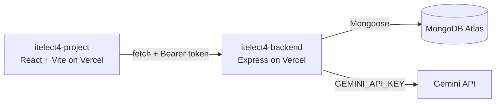

# itelect4-backend

[](https://github.com/LancePr0/itelect4-backend/actions/workflows/ci.yml)

The REST API behind the Tricycle Complaint System, built for the ITELECT4 course: Express 5 in TypeScript, MongoDB Atlas through Mongoose, JWT login, and an AI route that reviews a complaint description with Google Gemini before it's filed.

- **Live API:** https://itelect4-backend-sigma.vercel.app/api/health
- **Frontend repo:** https://github.com/LancePr0/itelect4-project
- **Frontend live:** https://itelect4-project-fawn.vercel.app

## What it does

- Register / log in, issuing a JWT
- Public, read-only tricycle directory (`GET /api/tricycles`)
- Full CRUD on complaints, scoped to the logged-in user (`/api/complaints`)
- `POST /api/ai`, rate-limited and behind a token, that asks Gemini to review a complaint description before it's filed

## Architecture



## Running it locally

```bash
npm install
cp .env.example .env   # fill in MONGODB_URI, JWT_SECRET, CORS_ORIGIN, GEMINI_API_KEY
npm run seed            # seeds the three reference tricycles
npm run dev              # http://localhost:4000
```

Run the tests with `npm test`; `npm run typecheck` runs the same type check the CI pipeline does.

## AI-use disclosure

This project was built with help from Claude (Anthropic) as a pair-programming assistant across the course's sessions -- explaining each session's concepts, writing and editing code, diagnosing bugs, and walking through deployment. Every change was reviewed, run, and tested locally before being committed.
